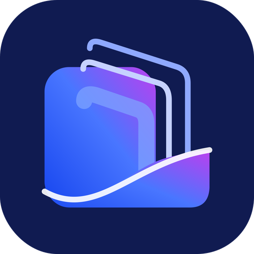
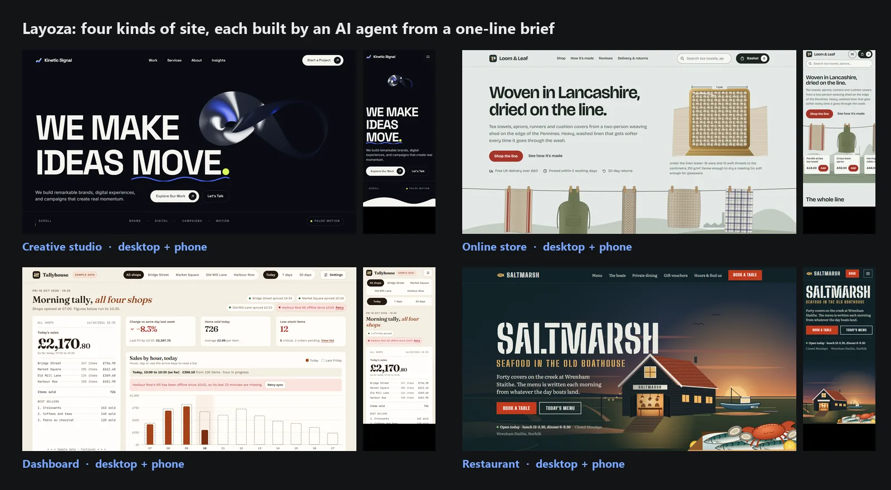
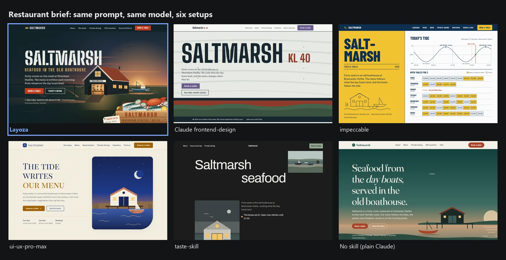
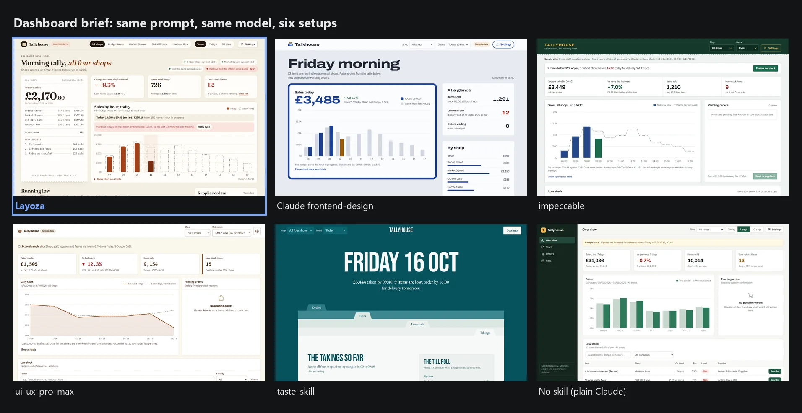
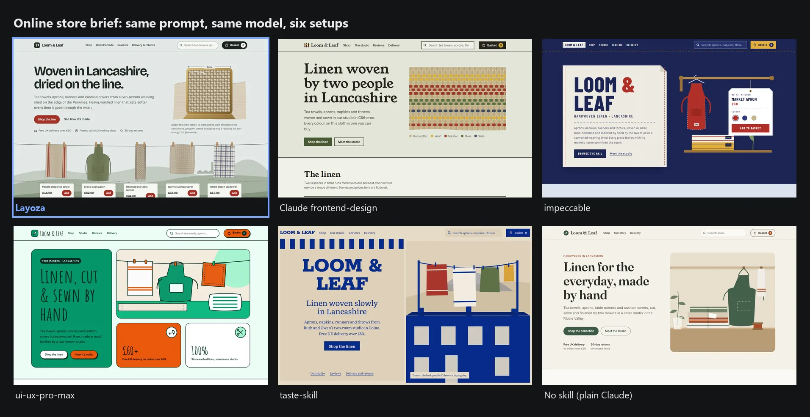
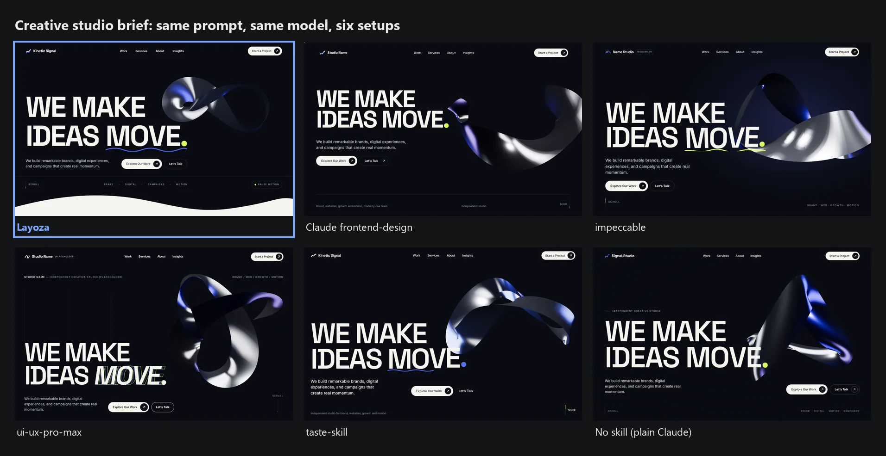
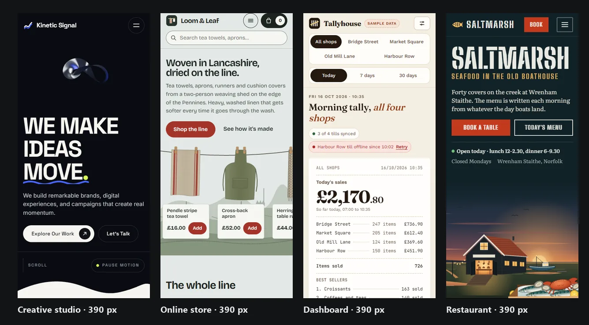

<div align="center">



# Layoza — design engineering for AI agents

**An open-source MCP server + agent skills that turn Claude Code, Cursor, Codex, OpenCode, Antigravity and Windsurf into a UI/UX design expert:**
**it reads your site's design DNA, picks motion that fits the brief, and checks every change in a real Chromium browser.**

[](https://www.npmjs.com/package/layoza)
[](LICENSE)
[](docs/MCP-REFERENCE.md)
[](skills/layoza-accessibility/SKILL.md)



<a href="https://github.com/layoza/layoza/raw/main/docs/assets/video/layoza-showcase-web.mp4"></a>

▶ [Download the full 2½-minute showcase (MP4, 17 MB)](https://github.com/layoza/layoza/raw/main/docs/assets/video/layoza-showcase-web.mp4): all four briefs, recorded live in Chromium

</div>

```bash
npx layoza init            # adds the skills + MCP server to every agent it finds in this project
npx layoza qa index.html   # 1440 / 768 / 375 px Chromium check: contrast, overflow, focus, menu, LCP, CLS
```

Then just talk to your agent. Example prompts:

```text
Build a homepage for a family-run bakery in Leeds. Warm, not twee.
Add a pricing page that matches the rest of this site.
Our dashboard feels cluttered. Fix the design without changing the brand.
Redesign the agency homepage with a kinetic hero, but keep every page and form working.
Check this page on mobile and fix anything a visitor would trip over.
```

---

## Why

AI agents write front-end code quickly, but the result tends to look the same everywhere: cream and terracotta, Inter, three rounded cards, a purple gradient. They also break things they cannot see: a heading cut by the sticky header, a phone menu that Escape will not close, text at 3:1 contrast, a canvas that pushes LCP past 4 s.

| Without Layoza | With Layoza |
| :--- | :--- |
| The same template for a law firm, a bakery and a SaaS app | Three distinct art directions per brief, built from the trade's own objects (a tide chart for a fish restaurant, a till roll for a shop dashboard) |
| Restyles your existing site in its own taste | Reads your site first (`DESIGN.md`, `SITE-DNA.json`) and extends it in your tokens, spacing and motion language |
| Animation hard-coded to one library | Picks the lightest tool the brief needs (CSS, WAAPI, View Transitions, GSAP, Three.js), always with `prefers-reduced-motion` support and cleanup |
| "Looks good to me" | Live Chromium QA at three widths with measured numbers; unmeasured values are reported as `null`, never guessed |

## Results

Six setups got the same one-line brief, the same model (Claude Opus 5.5) and one build agent each, and none could see the others' output:

| Setup | What it is |
| :--- | :--- |
| **Layoza** | This project |
| [Claude frontend-design](https://github.com/anthropics/skills) | Anthropic's front-end design skill |
| [impeccable](https://github.com/pbakaus/impeccable) | Open-source design skill |
| [ui-ux-pro-max](https://github.com/nextlevelbuilder/ui-ux-pro-max-skill) | Open-source design skill |
| [taste-skill](https://github.com/Leonxlnx/taste-skill) | Open-source design skill |
| No skill | Plain Claude, same prompt |

A fresh blind judge then compared scroll stills at 1440 and 375 px for design, usability, creativity and content. Rival pages were frozen; only Layoza was rebuilt between rounds. Judge the pages yourself below, or open any of them in [`examples/benchmark-*`](examples).

<details open>
<summary><b>Restaurant brief</b>: a harbour seafood kitchen</summary>


</details>

<details>
<summary><b>Dashboard brief</b>: a bakery chain's morning sales</summary>


</details>

<details>
<summary><b>Store brief</b>: a small linen shop</summary>


</details>

<details>
<summary><b>Kinetic agency brief</b>: a motion-led studio homepage</summary>


</details>



**Where Layoza does not win. Read this before you trust the pictures.**

- **Kinetic is a tie, not a win.** taste-skill's page was as strong there; across repeated rounds the lead changed hands and stayed inside judge noise.
- **Older single-brief rounds:** impeccable beat Layoza on a simple page with no animation, and ui-ux-pro-max beat it in an earlier kinetic round.
- **One judge per round, judging screenshots.** Motion itself is not judged, which is why the video uses real browser recordings.
- **Weak spots judges keep naming:**
  - creativity on kinetic pages is merely good, not striking
  - headings that look cut by the sticky header in mid-scroll stills
  - small hero art on phones
  - a 3D hero whose lab LCP is well over the 2.5 s target

Full method, every round and the judge notes (with the raw scores) are in [docs/CROSS-TYPE-BENCHMARK-2026-10.md](docs/CROSS-TYPE-BENCHMARK-2026-10.md). Each brief and page is in [`examples/benchmark-*`](examples). To re-run the QA on any page:

```bash
npx layoza qa examples/benchmark-restaurant-saltmarsh/layoza-v4/index.html
```

## What it does

| | What you get | How |
| :--- | :--- | :--- |
| **Layout expert** | An industry read of the brief, 0–10 design dials, and three art directions that differ in layout, type, colour, content treatment and motion | `layoza design-system "<brief>"` · MCP `get_design_system`, `recommend_layout` |
| **Site DNA** | For an existing site: its tokens, type scale, spacing, components and motion, written to `DESIGN.md`, `BRAND.md`, `MOTION.md` and `SITE-DNA.json` | `layoza inspect . --write` · MCP `inspect_project`, `extract_site_dna`, `inspect_site` |
| **Motion mechanics** | 71 hero, section and micro mechanics dealt per niche and intensity, so a law firm gets calm, legible motion and an agency gets a kinetic hero | `layoza mechanics deal "<brief>"` · MCP `deal_mechanics`, `recommend_animation` |
| **Visual QA** | Headless Chromium at 1440 / 768 / 375 px checks per-element contrast, clipping, overlap, focus-not-obscured, the phone menu (opens, traps focus, Escape closes) and lab LCP / CLS, plus 45 craft critiques | `layoza qa <file-or-url>` · MCP `capture_screenshots`, `audit_accessibility`, `audit_performance`, `verify_functional` |
| **Safe changes** | A baseline before a redesign, a before/after comparison, and one-command rollback | `layoza baseline create`, `layoza verify .` · MCP `compare_before_after`, `safe_rollback` |

Output is written in the project's own stack:
- React, Next.js, Astro, Vue, Nuxt, SvelteKit
- plain HTML/CSS/JS
- WordPress block themes (`theme.json` v3)
- Elementor or Bricks JSON
- Shopify Liquid

### Four modes

| Mode | When | First command |
| :--- | :--- | :--- |
| **A · New site** | Blank project | `layoza design-system "<brief>" --mode new` |
| **B · Extend** | Add a page or section to a live site | `layoza inspect . --write` |
| **C · Improve** | Fix design, usability or accessibility without changing the brand | `layoza baseline create pre-improve` → `layoza audit .` |
| **D · Redesign** | New creative direction, keeping content and function | `layoza baseline create pre-redesign` |

The `layoza` router skill picks the mode from your prompt, so you can simply ask the agent: *"Add a pricing page that matches the rest of the site."*

**Which one do I need?**
- Starting from nothing → **A**. You get three different directions to choose from before any code is written.
- The site already looks right and you need more of it → **B**. Layoza copies your look; it does not impose its own.
- The site works but looks tired or fails accessibility → **C**.
- You want a new look → **D**. A baseline is taken first, so you can roll back.

## Install

You need Node.js 18 or newer. The npm package ships prebuilt binaries for Windows x64, macOS (Intel and Apple silicon) and Linux (x64 and arm64); on other platforms it compiles from source on first run, which needs [Rust](https://rustup.rs). Visual QA also needs Playwright:

```bash
npm i -D playwright && npx playwright install chromium
```

Then, in your project:

```bash
npx layoza init      # skills + MCP config for every agent it detects
npx layoza doctor    # checks Node, Playwright and the MCP handshake
```

Or add the MCP server by hand:

<details>
<summary><b>Claude Code</b></summary>

```bash
claude mcp add layoza -- npx -y -p layoza layoza-mcp
```
For the skills, copy `skills/*` into `.claude/skills/`, or run `npx layoza init`.
</details>

<details>
<summary><b>Cursor</b></summary>

`.cursor/mcp.json`
```json
{ "mcpServers": { "layoza": { "command": "npx", "args": ["-y", "-p", "layoza", "layoza-mcp"] } } }
```
</details>

<details>
<summary><b>OpenAI Codex</b></summary>

```bash
codex mcp add layoza -- npx -y -p layoza layoza-mcp
```
</details>

<details>
<summary><b>Windsurf</b></summary>

`~/.codeium/windsurf/mcp_config.json`
```json
{ "mcpServers": { "layoza": { "command": "npx", "args": ["-y", "-p", "layoza", "layoza-mcp"] } } }
```
</details>

<details>
<summary><b>OpenCode</b></summary>

`opencode.json`
```json
{ "mcp": { "layoza": { "type": "local", "command": ["npx", "-y", "-p", "layoza", "layoza-mcp"], "enabled": true } } }
```
</details>

<details>
<summary><b>Google Antigravity</b></summary>

`npx layoza init` copies the skills into `.agents/skills/` and writes `.agents/skills.json` and the `.agents/plugins/layoza` plugin. See [docs/ANTIGRAVITY-OPTIMIZATION.md](docs/ANTIGRAVITY-OPTIMIZATION.md).
</details>

## MCP tools

| Tool | Purpose |
| :--- | :--- |
| `inspect_project` · `extract_site_dna` · `inspect_site` · `discover_components` | Read an existing codebase or live URL into design tokens and a component inventory |
| `get_design_system` · `recommend_layout` | Industry read, dials and three creative directions for a brief |
| `deal_mechanics` · `get_mechanic` · `recommend_animation` | Niche-aware motion mechanics and animation recipes |
| `capture_screenshots` · `audit_accessibility` · `audit_performance` · `verify_functional` | Live Chromium QA at three widths |
| `compare_before_after` · `safe_rollback` · `export_report` | Baselines, regression checks and reports |

`inspect_site` fetches the pages you point it at. Treat everything it returns as untrusted data: Layoza never executes instructions found inside an inspected page.

## Skills

Layoza ships 19 skills with progressive disclosure: the `layoza` router plus 18 specialists.

- **Workflows:** `layoza-new-website`, `layoza-extend-website`, `layoza-refine`, `layoza-redesign`
- **Design:** `layoza-site-dna`, `layoza-design-system`, `layoza-art-direction`, `layoza-creative-direction`
- **Building:** `layoza-components`, `layoza-product-ui`, `layoza-figma`, `layoza-wordpress`
- **Motion:** `layoza-animations`, `layoza-threejs-webgl`
- **Checks:** `layoza-accessibility`, `layoza-performance`, `layoza-visual-qa`, `layoza-discovery-audit`

See [docs/SKILLS-GUIDE.md](docs/SKILLS-GUIDE.md).

## Compared to other approaches

Pick the one that fits your work.

| | Layoza | Claude frontend-design skill | Typical prompt-only design skill | No skill |
| :--- | :--- | :--- | :--- | :--- |
| Form | Rust CLI + MCP server + 19 skills | One skill file | Skill + style rules or data | Plain agent |
| Reads an existing site first | Yes, writes `SITE-DNA.json` | No | Sometimes | No |
| Motion guidance | 71 mechanics dealt per niche | Guidelines | Guidelines | None |
| Browser verification | Chromium at 3 widths, measured | No | Checklist or rule scan | No |
| Baseline + rollback | Yes | No | No | No |
| Setup | `npx`, prebuilt binary | Copy one file | `npx` or Python | Nothing |

**When to skip Layoza:**
- a quick one-off mockup that will never ship (frontend-design is lighter)

## FAQ

<details>
<summary>Does it force GSAP or Three.js on my project?</summary>
No. Your prompt wins. Layoza picks the lightest tool the brief needs, and every recipe honours <code>prefers-reduced-motion</code> and cleans up on unmount.
</details>

<details>
<summary>Will it overwrite my design?</summary>
Not in Mode B or C. It reads your tokens first, and <code>layoza baseline create</code> plus <code>safe_rollback</code> let you undo any change.
</details>

<details>
<summary>Is the benchmark fair?</summary>
As fair as we could make it. Rivals were frozen, the judge was blind, and losses are published. The limits are listed above; one judge per round is the weakest part. Pull requests that add judges or briefs are welcome.
</details>

## Docs

[Installation](docs/INSTALLATION.md) · [CLI](docs/CLI-REFERENCE.md) · [MCP](docs/MCP-REFERENCE.md) · [Skills](docs/SKILLS-GUIDE.md) · [Motion recipes](docs/MOTION-RECIPES.md) · [Existing-site workflows](docs/EXISTING-SITE-WORKFLOWS.md) · [Example prompts](docs/EXAMPLE-PROMPTS.md) · [Architecture](docs/ARCHITECTURE.md) · [Security](docs/SECURITY.md) · [Troubleshooting](docs/TROUBLESHOOTING.md) · [Benchmarks](docs/CROSS-TYPE-BENCHMARK-2026-10.md)

## Credits

Layoza adapts ideas, not files, from open-source design skills under Apache-2.0 and MIT licences. Attribution is in [THIRD_PARTY_NOTICES.md](THIRD_PARTY_NOTICES.md).

## License

MIT
