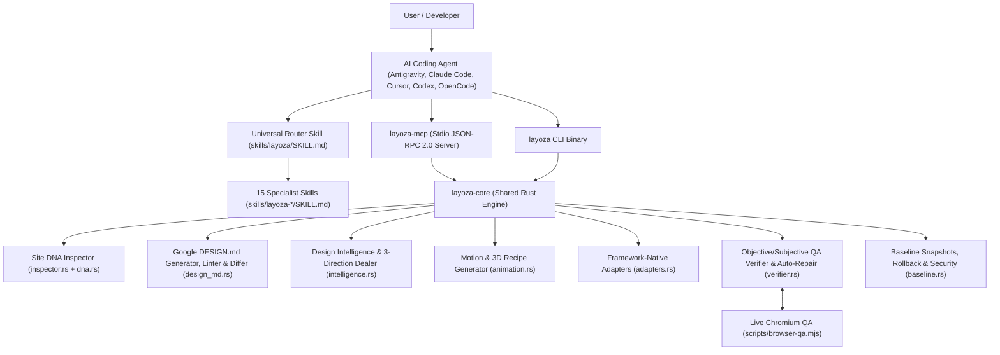

# Layoza System Architecture

Layoza is architected around a **Single Source of Truth** in Rust (`crates/layoza-core`) consumed identically by the CLI (`crates/layoza-cli`), the MCP server (`crates/layoza-mcp`), and the 16 progressive-disclosure skills (`skills/`).

## Core Modules in `crates/layoza-core`

1. **`dna.rs`**: Canonical data structures for `SiteDna`, `ColorToken`, `TypographyToken`, `SpacingScale`, `ComponentInventory`, `ExtractionConfidence`, and `ProvenanceTag` (`ObservedSource`, `ObservedBrowser`, `InferredRule`, `UserApprovedDecision`).
2. **`inspector.rs`**: Scans local repositories (`package.json`, `theme.json`, CSS custom properties, routes, UI components, motion libraries) and merges live browser DOM snapshots, computing a deterministic SHA-like baseline hash.
3. **`design_md.rs`**: Generates, parses, lints, and diffs `DESIGN.md` files aligned with the Google `DESIGN.md` format, including exact WCAG 2.2 AA relative luminance contrast math.
4. **`intelligence.rs`**: Implements Operating Modes A/B/C/D, 18 industry profiles, searchable style taxonomy with upstream provenance, 0–10 behavioral dials (`DESIGN_VARIANCE`, `MOTION_INTENSITY`, `VISUAL_DENSITY`), and the 3-direction creative concept dealer.
5. **`animation.rs`**: Generates seek-safe, reduced-motion-compliant choreography recipes for GSAP, ScrollTrigger, WAAPI, CSS View Transitions, magnetic interactions, conditional Lenis smooth scroll, and Three.js / React Three Fiber with explicit GPU disposal and DPR capping.
6. **`adapters.rs`**: Generates framework-native code for React, Next.js, Astro, WordPress Gutenberg Block Themes (`theme.json` v3), HTML/CSS/JS, Vue, Nuxt, SvelteKit, Elementor JSON, Bricks JSON, and Shopify Liquid.
7. **`verifier.rs`**: Separates objective deterministic browser checks from subjective design rubric scoring, distinguishes automated vs manual accessibility checks, labels Lab vs Field Core Web Vitals honestly, and computes bounded auto-repair actions.
8. **`baseline.rs`**: Creates `.layoza/baselines/<id>` snapshots, performs 1-command rollbacks, prevents path traversal (`..`), sanitizes untrusted web/DOM text against prompt injection, and redacts secrets.
